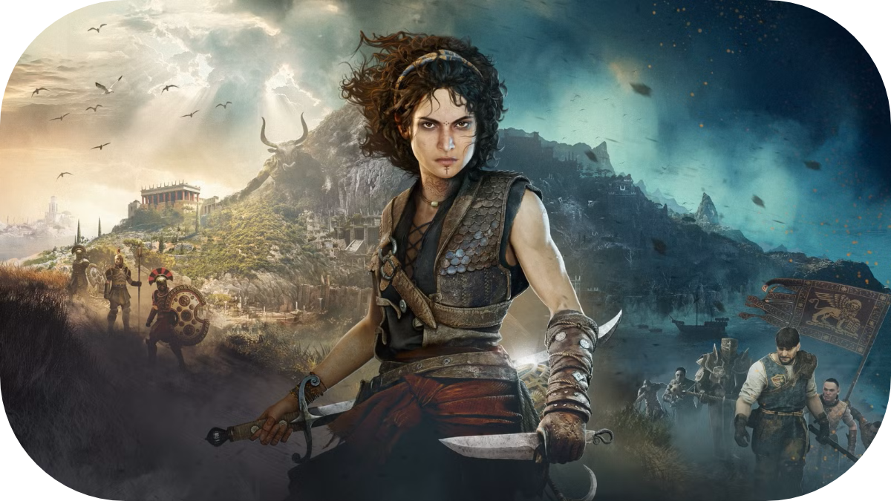
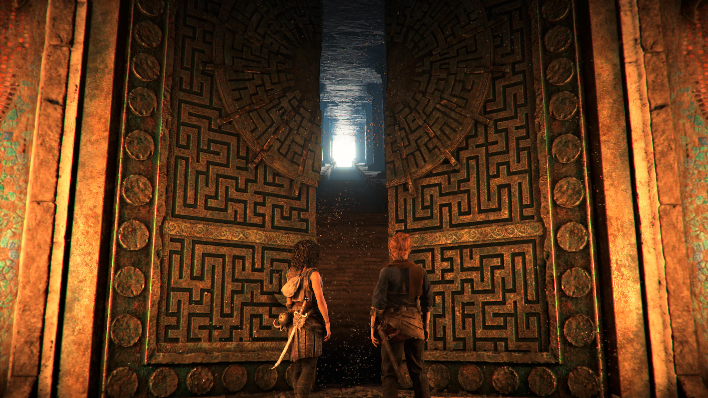
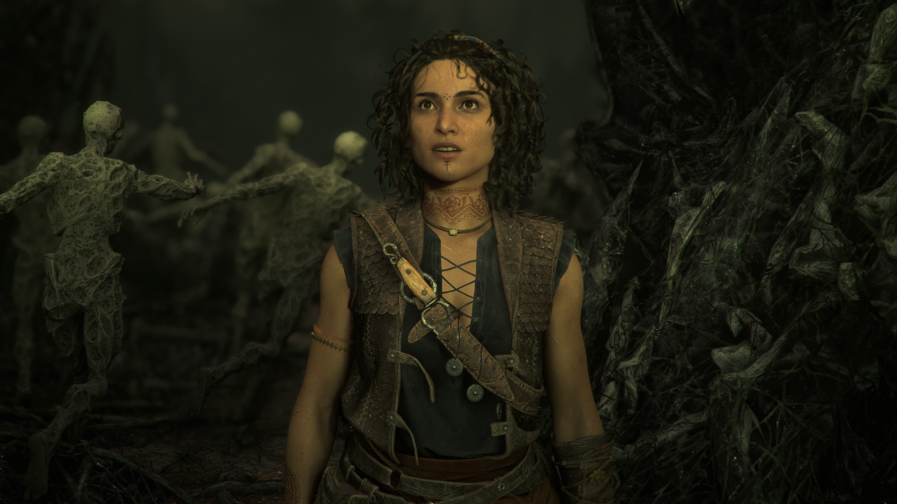
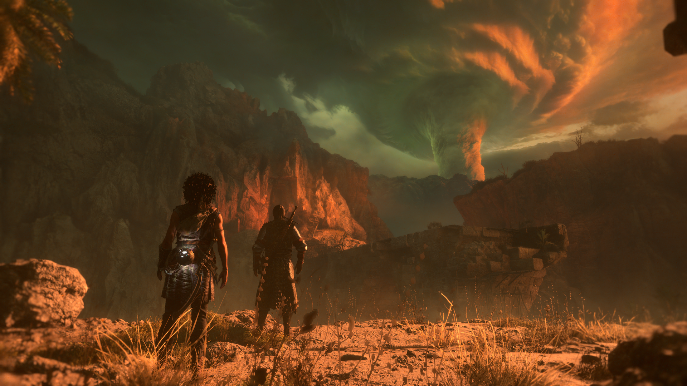

  

    <a href="https://nightlypixel.com/pages/Reviews.html" style="color: #1FBCF0; text-decoration: none;">Reviews</a>
  

  

    <h1><b>Resonance: A Plague Tale Legacy Review</b></h1>
    <h4 style="font-weight: 300; font-size: 10px;">First Published: November 11, 2026</h4>
     
    <h4 style="font-weight: 500; color: #5E787D;">"Ahh no rats"</h4>
  

 
   

  

    
    

      
Jose Balderas

      
GT: II Above II

    
    
  

  

 

I’ve always avoided the Plague Tale series not because they didn’t interest me, but because I have a phobia of rodents, and, honestly, rats give me the ick. Thankfully, that’s not what Resonance is. It’s been a while since I played a game like this; lately I’ve been playing Forza, Gears, and other games different from this genre. What I can say is that, honestly, this game captivated me more than I imagined. At first I thought I'd drop this game after a couple of tries to get into it, but it stuck with me from the beginning, and after that, it was all I was dedicated to playing (I even dropped Gears E-Day multiplayer for it).

There were plenty of reasons why I could have avoided this game: the fact that it’s the third game in the series, or that it has its fair amount of stealth, which sadly I'd fallen out of love with at the time, but actually I think it’s one of the better games I’ve played this year (not that I’ve played many). The main reason is the story; it grabbed me right from the start. I was intrigued by what was happening to Sophia, why she drew those things from her visions, and, from a little knowledge of the previous games, what the danger in this game is. In a way, this game brought back feelings I had when I first played Assassin’s Creed. I know there are plenty of games that fit that formula; the truth is I just haven’t been playing this type of game at all anymore.

The characters in this game all grew on me a little, even the ones I wasn’t a big fan of, like Leni, who tags along with you for a good amount of the story; they never get overly frustrating or interrupt the story to the point where it becomes a nuisance, which is something I’ve noticed a lot of games having lately. Trust me, I have bad takes most of the time, and some characters I like can be annoying, but Sophia wasn’t bothersome at all; she was well developed, and you get her emotions pretty straightforward without them feeling unwarranted. The way they all interact is a breeze; no one has too much to say unless you’re asking for assistance yourself. Most of the time, the chatter is quiet unless they’re dropping a bit of information in a side conversation or playful banter.

The story in itself is mysterious. As I stated before, I have little knowledge of the previous games, so I can’t really say if it matches the likes of the other Plague Tale games or if they have significant connections, but as a first-time player in this particular story, it has its moments, and I was hooked from beginning to end. With a three-way race to the end to find the treasure or the mystery of Sophia's visions, along with some betrayal and a few more twists in this story, I'd say it was properly done. Asobo has been delivering great work; with previous games being well rated, this one doesn’t miss its mark either. I felt like everything in this game creatively explained something new, and every path you took told a story of the past in such a way that it made me admire it even more, but that should be something you discover on your own.

<h1>Combat and Stealth</h1>

Unfortunately, the part that fell a little bit flat for me was the combat in itself; it’s simple most of the time. I felt like I was spamming the buttons, which didn’t ask much of me and was a little more to be desired. With a pretty minimal upgrade tree and a few skill-based weapons, it didn't improve combat much, making the game rely heavily on parrying. As for stealth, it was simple but, thankfully to me, and probably only my opinion, just right since I wasn’t up for a stealth-heavy game. The UI worked well; it split everything up in a simple way you could easily maneuver through. Nothing was hard to understand, with no clutter, making it straightforward and appealing.

I played this game on my Xbox Series X, so the quality I can provide is only for this console. This game was wonderful and looked beautiful every step of the way. I played on performance mode over quality, and even then I didn’t run into a problem; nothing ruined my experience. As for the graphics, I was left speechless by this team; it’s one of the nicest games I’ve seen in a while, aside from the graphical showcase that Gears E-Day has been, but they really hit it out of the park with the way it looks and plays.

Overall, this game hits the mark for me as one of the better games to come out this year, with a great story and beautiful graphics. Resonance was so good that I’d recommend you give it a try. I didn’t feel like my knowledge of the previous ones made much difference, but as my intro to this series, it was a good place to jump in without feeling like I missed important information. Maybe I did. Who knows? I sure won’t until I get around to playing the others, and honestly, now I am interested in giving those a try.

[back](./)
