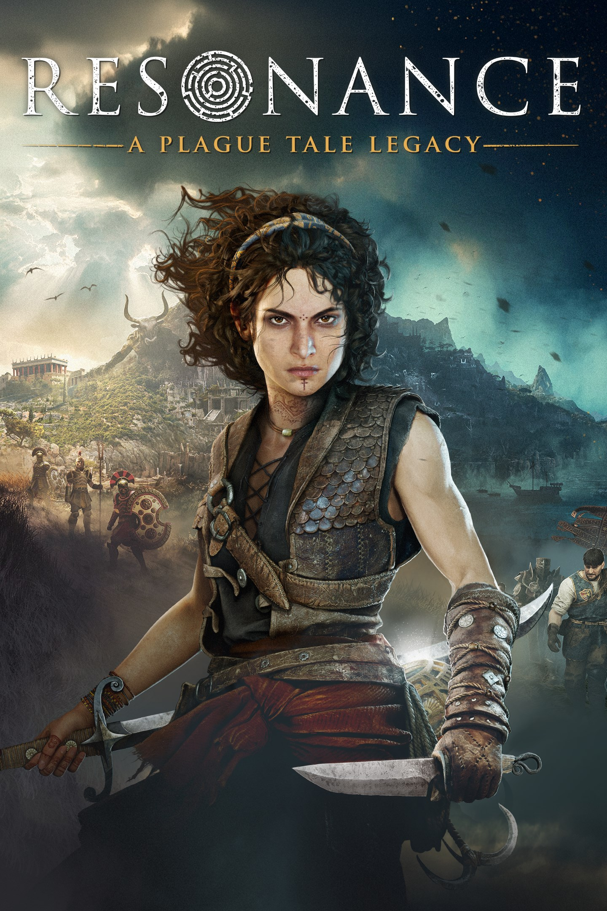

<!-- Hero Section for Latest Post -->



  <a href="{{ latest_post.url | relative_url }}" title="Read {{ latest_post.title }}" style="display: block; width: 100%; height: 100%; text-decoration: none;">
    
    

    <!-- Custom Text Overlay -->
    

      <h2 style="color: #ffffff; margin: 0; font-size: 24px; line-height: 1.2; text-shadow: 1px 1px 3px rgba(0,0,0,0.8);">No Rats? Sounds Like A Game For Me</h2>
    

  </a>

<!-- Rest of your normal index content follows below -->

  

    

  
  

    

      <a href="https://nightlypixel.com/pages/Reviews.html" style="color: #1FBCF0; text-decoration: none;">Reviews</a>
    

    

      <a href="https://nightlypixel.com/2026/11/12/resonance-review.html" style="color: #5E787D; text-decoration: none;">Resonance: A Plague Tale Legacy Review</a>
    
   
     
November 11,2026

    
Plague Tale wasn't for me, but a game without rats? That's something I can get into.

  

  

  

    <h4>Table of contents</h4>
    <a href="/2026/11/12/resonance-review.html" style="color: #363636;">Resonance: A Plague Tale Legacy</a>
  

  
  

    

      <a href="https://nightlypixel.com/pages/Reviews.html" style="color: #1FBCF0; text-decoration: none;">Reviews</a>
    

    

      <a href="https://nightlypixel.com/2026/11/12/resonance-review.html" style="color: #5E787D; text-decoration: none;">Resonance: A Plague Tale Legacy Review</a>
    
   
     
November 11,2026

    
Plague Tale wasn't for me, but a game without rats? That's something I can get into.

  

